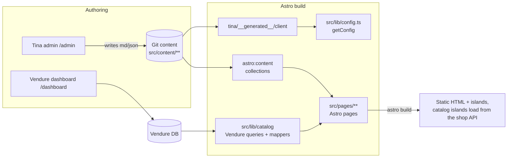

# Architecture

This document describes how the Babasarok website is structured, how content
and data flow through it at build time and runtime, and where the main
opportunities for improvement are.

> Conventions and priorities live in [AGENTS.md](../AGENTS.md). This document is
> the higher-level "how the pieces fit together" map.

## 1. Stack overview

| Concern             | Technology                                                                                   |
| ------------------- | -------------------------------------------------------------------------------------------- |
| Site framework      | **Astro 7** (`output: "static"`)                                                             |
| Interactive islands | **Svelte 5** (runes), hydrated only where needed                                             |
| Styling             | **Tailwind CSS 4** (`@theme` tokens in `src/styles/global.css`)                              |
| Catalog             | **Vendure** (self-hosted backend; dashboard editors, shop API)                               |
| CMS / content       | **TinaCMS** (Git-backed, Tina Cloud in prod, `--local` in dev/CI) — non-catalog content only |
| Markdown            | MDX + a custom `remark-asset-images` plugin                                                  |
| Images              | `astro:assets` (`sharp`), responsive `layout: "constrained"`                                 |
| Fonts               | `astro:assets` Google font provider (Poppins, Yeseva One)                                    |
| Orders              | Native Vendure checkout: basket = active order, server-side pricing                          |
| Tests               | Vitest (unit), Playwright (hydration), dist guard scripts                                    |

The site is a **static, build-time-first** application. Client JavaScript is
limited to a handful of Svelte islands (most significantly the order form). This
directly reflects the core values in [AGENTS.md](../AGENTS.md): build-time & no-JS
first, standardised over bespoke, no global CSS.

## 2. High-level data flow



Three content sources, each with one job:

1. **Vendure catalog** — products, materials, product groups, thread colors,
   delivery methods and orders live in Vendure. `src/lib/catalog/*` queries the
   shop API and maps responses into the site's shapes. Catalog pages are
   static shells whose islands load the catalog **in the browser** through
   the catalog store (ADR 0017), never at build time; only the product and
   material detail routes render on demand, so crawlers get the item's meta.
2. **TinaCMS path** — Tina authors the non-catalog content (site config,
   landing sections, blog/reference posts, contact, privacy, terms, checkout
   copy). `src/lib/config.ts` fetches `config.json` through the generated Tina
   client for a few prerendered pages; the layout, header and footer read the
   same file through the `config` collection, so no page reads Tina at request
   time. The rest is read by Astro content collections. Tina holds **no product
   data** (roadmap principle 1).
3. **Astro content collections** — `getCollection(...)` over the same
   `src/content` files so list pages get `astro:assets` `ImageMetadata` and
   `<Image>` optimization.

## 3. Directory map

```
src/
  layouts/Base.astro        # <html> shell: SEO/OG meta, favicons, fonts, Header/Footer, ClientRouter
  pages/                    # Static; only catalog detail routes render on demand (ADR 0017)
    index.astro             # Landing: Hero + Service + About + Product + Blog
    contact.astro           # Order form island + contact info
    product/[...page].astro  + [id].astro   # Paginated list + detail (Vendure)
    material/...            # Paginated list + detail (Vendure)
    blog/...                # Paginated list + detail
    checkout.astro          # Native checkout island over the active order
    rss.xml.ts              # RSS feed
    site.webmanifest.ts     # PWA manifest (endpoint)
    src/                    # (Tina admin image-serving endpoint area)
  components/
    blocks/                 # Page-section components (Hero, Service, About, Product, Blog, Header, Footer)
    blocks/order/           # Order configurator Svelte island + sub-components
    ui/                     # Reusable presentational components (Button, *Card, Pagination, ...)
    blocks/ConsentBanner.svelte  # Consent banner island; gates GTM + Meta pixel loading
  lib/                      # Framework-agnostic logic + data loaders
    config.ts               # The one Tina client read: global site config
    catalog/                # Vendure shop-API queries, zod schemas, mappers, live pricing
    tracking.ts             # Consent storage + consent-gated GTM / Meta pixel loading
    types.svelte.ts / typeHelpers.ts / cn.ts / uuid.ts / scrollSnapper.ts
    assets/                 # resolveImage() (index.ts), tinaImageUrl, remarkAssetImages
    product/                # field{Types,Value,Visibility}, materials, validation (product-config domain)
    order/                  # types, basket.svelte, product, queryParams, storage, submit, groups, priceBreakdown
    vendure/                # Shop-API transport + image URLs
    __tests__/              # Vitest specs + fixtures
  styles/                   # global.css (@theme tokens), base.css, prose.css, theme.css
  content/                  # Tina-managed md/json (the data)
tina/                       # Tina schema (collections/*.ts), config.ts, generated client
scripts/                    # test/no-tina-cloud-urls.ts
tests/                      # Playwright hydration.spec.ts
```

## 4. Key subsystems

### 4.1 Layout & SEO (`src/layouts/Base.astro`)

Single shell for every page. Pulls global config from Tina (`getConfig()`) for
title/description/OG/theme-color, emits canonical + Open Graph tags, preloads
fonts, wires favicons through the Vite asset pipeline, and includes
`ClientRouter` (view transitions) and the Meta Pixel.

### 4.2 Content modelling (Tina, Astro collections, Vendure)

- **Tina collections** (`tina/collections/*.ts`) define the editable schema for
  non-catalog content: global config, the landing sections, blog/reference
  posts, contact, privacy, terms and checkout copy. The product, material,
  delivery-method, embroidery and product-group collections were removed with
  the epic-4 cleanup — the catalog lives in Vendure only.
- **Astro collections** (`src/content.config.ts`) re-declare the non-catalog
  content with Zod schemas so pages can use `getCollection()` + `<Image>`.
- **Order-island types.** `src/lib/order/types.ts` hand-writes the shapes the
  order island consumes (`OrderProduct`, `OrderField`, `OrderThreadColor`,
  …); `src/lib/catalog/orderProduct.ts` maps Vendure data into them. The
  mappers' assignments and the components keep the types honest in both
  directions — there is no generated schema behind them anymore.
- **Shared value lists live in one module.** Where the same enumerated values are
  needed by the Tina schema, the Zod schema, and runtime code, they are defined
  once and imported by all three (e.g. `src/lib/product/fieldTypes.ts`).
  Tina config imports these with a **relative** path — its esbuild bundling
  ignores the `@/` tsconfig alias.
- **Discriminated unions are a runtime/form-side concern.** The flat stored
  shape keeps a single record with an enum tag; per-type value unions are built
  by distributing over the shared tag in `src/lib/types.svelte.ts`, not
  declared in the schema.

### 4.3 Image resolution

Images are the most intricate part of the system because Tina stores references
as **paths** (`/src/assets/...` locally, or `https://assets.tina.io/.../__file/...`
in cloud builds) while Astro wants `ImageMetadata` objects from `src/assets`.

- `src/lib/assets/index.ts` `resolveImage()` normalizes both forms to a hashed
  `/_astro/...` asset.
- `src/lib/assets/remarkAssetImages.ts` rewrites image references inside the
  Markdown `<Content/>` pipeline.
- `scripts/test/no-tina-cloud-urls.ts` is a CI guard that fails the build if any
  `assets.tina.io` URL survives into `dist/`.

### 4.4 The order islands (`components/blocks/order/`, `components/blocks/checkout/`)

The main pieces of client-side state are the product-page configurator and the
checkout. Product pages render `<ProductOrder client:load>` (in
`blocks/order/`) to build up a basket item. `checkout.astro` renders
`<CheckoutSection client:load>` (in `blocks/checkout/`), which loads the
catalog labels and mounts the checkout wizard: `steps/` holds one form per
flow (Kapcsolat, Szállítás, Számlázás, Áttekintés), `summary/` the order
summary (desktop column, mobile sheet), `wizard/` the step chrome. Shared
primitives (buttons, inputs, sheet) live in `components/ui/`. The wizard keeps
no copy of the form: inputs start from the active order, saves read the forms
with `FormData` and replace the order with Vendure's response. Domain logic is
extracted into `src/lib/`:

- `order/types.ts` — the island's data shapes, mapped from Vendure by
  `catalog/orderProduct.ts`
- `order/priceBreakdown.ts` — the display-only price breakdown; the
  authoritative unit price comes from the shared pricing package via
  `catalog/livePrice.ts` (the same logic the server prices orders with)
- `order/groups.ts` — set/related-items grouping over catalog product groups
- `materialUtils`/`validation` (`product/`) — material/color resolution and
  field validation
- `basket/` — the active order: the Vendure session token, add/adjust/remove,
  the checkout's order ↔ form ↔ native-mutation mapping
  (`basket/checkoutValues.ts`), the serial step saves
  (`basket/checkoutSaves.ts`), per-step checks (`basket/readiness.ts`) and
  native submission (`basket/submit.ts`: customer → delivery address →
  shipping method → billing address → order custom fields → transition to
  placed)

Submission runs the native Vendure order flow against the shop API (the
backend prices every line server-side and emails buyer + owner). Unit tests
next to the code cover the pricing/validation and checkout mapping logic;
checkout E2E covers the full journey; `catalog/contract.test.ts` and
`basket/contract.test.ts` check the query shapes against a live shop API.

### 4.5 Build & tooling specifics

- `npm run dev` runs, via `concurrently -k` (any exit or Ctrl+C stops all):
  postgres (docker compose, foreground, stopped with the rest) + the Vendure backend (:4000), the
  dashboard vite dev server (:5173, proxied at `/dashboard` by
  `integrations/dev-proxy.ts`), and `tinacms dev -c "astro dev"` (Tina backend
  on :4001 + Astro on :4321). Plain `astro dev` cannot reach Tina.
- `npm run build` talks to Tina Cloud (needs creds); `npm run build:local` is the
  self-contained, cred-free local/CI build.
- Scoped npm `overrides` pin `vite ^7` globally but `^4.5.9` for `@tinacms/cli`
  (incompatible Vite expectations). Install with `--ignore-scripts`.
- CI (`.github/workflows/pr-checks.yml`): a `static` matrix (format/lint/
  stylelint/astro-check/svelte-check), a real `build`, then `test-tina-urls`,
  `test-hydration`, and `unit` jobs reusing the `dist` artifact.

## 5. Key points for improvement

These are ordered roughly by impact. They are observations, not yet committed
work.

### 5.1 Content-access paths (mostly resolved)

The catalog's dual access paths died with the Vendure cutover: only
non-catalog content remains, read through Astro collections with Tina as the
authoring UI (the Tina client reads just `config`). The remaining wrinkle is
small: the Tina schema and the Astro Zod schema for the same files can still
drift silently — the old `AssertTrue` parity machinery only ever covered the
catalog collections. A schema-parity check for the surviving collections would
close it.

### 5.2 Image resolution defensiveness

`resolveImage()` normalizing path-string vs Tina-Cloud URL vs content-collection
`ImageMetadata` is defensive by necessity of two authoring sources. The CI URL
guard (`scripts/test/no-tina-cloud-urls.ts`) is the backstop for Tina Cloud URLs
leaking into `dist/`; shrinking the surviving Tina surface (config + non-catalog
content only) keeps that surface auditable.

### 5.4 Build robustness

- `astro build` has historically failed on a Tailwind/rolldown `tsconfigPaths`
  error tied to the Vite version pin; keep an eye on upstream so the override can
  eventually be dropped.

### 5.5 Test coverage breadth

Strong unit coverage exists for the order-form pricing/validation logic, and
checkout E2E covers the order journey end to end. Gaps worth filling:
image-resolution (`resolveImage`) unit tests — the trickiest, most
regression-prone code.

### 5.6 Documentation & onboarding

Much of the hard-won operational knowledge currently lives only in agent/repo
memory (Vite override rationale, `--ignore-scripts`, Tina dev ports, the Plate
duplicate-dependency crash). Promoting the essentials into this repo's docs would
de-risk onboarding for humans who don't have that memory.

### 5.7 Per-field-type behaviour: a registry, not scattered `switch (field.type)`

The per-type answers a field needs (value resolution, price contribution, choice
enumeration, deep-link fill, persistence shape, validation, order-email record)
are currently re-implemented as a `switch (field.type)` in each consumer, which
makes a new field type an ~8-file change.
ADR 0006 moves them into an exhaustive `Record<ProductFieldType, FieldBehavior>`
(`src/lib/product/behavior/`) so implementation coverage is a compile error and
usage is enforced by a lint rule. (In progress.)

### 5.8 Island types next to their entity

`src/lib/types.svelte.ts` still holds the product-form types (`Field`, the
per-type value shapes, `IProduct`) derived from `order/types.ts`; moving them
next to the product domain completes an open task of ADR 0002.

### 5.9 Single source of truth for the remaining discriminants

`ProductType` and `ProductFieldType` already derive their union + values +
labels + type-guard from one `as const` list; the same treatment is missing for:

- **`ListSort`** (`product-list/query.ts`) — the sort list is duplicated across
  the hand-written union, the `parseListSort` `||` chain, the `applyListState`
  `switch` (carrying a live `eslint-disable unicorn/no-useless-switch-case`), and
  the hard-coded `<option>`s in `ProductList.svelte`. Derive it from one list +
  a `Record<ListSort, comparator>`; the select renders from the list, so a new
  sort mode is a compile error until it is implemented _and_ offered.
- **Saved field shape** (`order/storage.ts`) — the persisted zod union is built
  by _exclusion_ (`PRODUCT_FIELD_TYPE_VALUES.filter(t => t !== "toggle" && …)`),
  so a new field type silently inherits the string persistence shape. Derive it
  from `valueKind` in `fieldTypes.ts` and keep it structurally identical to the
  behaviour registry's `SavedFieldValue`.

Smaller: `content.config.ts` could split into per-collection schema modules.
